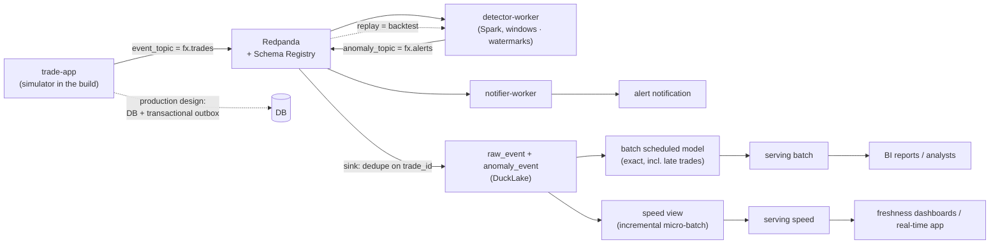

# F1 — Design Overview

> Real-time FX trading analytics platform. A design-first portfolio project: the goal is
> **architecture judgment**, so every component is chosen deliberately and defended in an ADR.
> Code exists to prove a design, not to ship a product.

## 1. Problem & scope

Detect anomalous FX trades in near real time, and give analysts accurate historical views of
trading activity, on a stack that runs on one 16 GB laptop.

**In scope:** synthetic FX trade stream, real-time anomaly alerts, analytical views,
detector grading against ground truth, infrastructure as code, optional read-only MCP server.

**Out of scope:** production uptime, real users, ML models (statistical rules first),
Kubernetes (scaling is argued on paper), a polished frontend.

## 2. Requirements

### Functional
- Synthetic FX producer with **labelled injected anomalies** and on-demand late / duplicate events.
- Real-time alerts from windowed statistics (price z-score, VWAP deviation, volume / account bursts).
- Analytical views: per-pair OHLC / VWAP / volume, anomaly history, detector precision & recall.
- Rule backtesting by replaying history through the same streaming job (Kappa property).
- Optional: read-only MCP server with named tools.

### Constraints
- Open-source **or source-available**, self-hostable, no paid licences (Redpanda is BSL: say "source-available").
- Runs on a 16 GB laptop with Docker Compose. No Kubernetes.
- Infrastructure as code with OpenTofu.

### Non-functional targets
| Dimension | Production design target | Laptop dev profile (Phase 1 sizing) |
|---|---|---|
| Throughput | 1–5k trades/s sustained, 20k/s bursts | 500/s sustained, 20k/s bursts |
| Alert latency | p95 < 5 s trade → alert | same |
| Analytics freshness | < 60 s | same |
| Late events | accepted up to 30 s (watermark); later → batch layer corrects | same |
| Delivery | at-least-once + idempotent sink (dedupe on `trade_id`) | same |
| Redpanda retention | 7 days (replay / backtest window), RF=3 | 24 h, RF=1 |
| Schema | Avro, BACKWARD compatibility via Schema Registry | same |

## 3. Architecture

Decided in [ADR-001](../adr/ADR-001-overall-architecture.md): **Kappa for alerts, Lambda for analytics.**

- **Alert path (Kappa):** `detector-worker` reads `event_topic`, writes `anomaly_topic`; `notifier-worker` sends alerts. Rule changes are backtested by replaying the log.
- **Analytics path (Lambda):** raw trades and fired alerts land as an immutable record; a scheduled batch model recomputes exact results (late trades included); a speed view gives fresh, approximate results.
- **Serving by use case:** reports read batch (exact, stale until the next run); freshness dashboards and the real-time app read speed (fresh, approximate).
- **Deciding axis:** timeliness (alerts) vs completeness (reports).
- **Production note:** trades originate in an OLTP service and reach the log via a transactional outbox (known improvement). The build is log-first, so it has no dual write.
- **Platform layer:** storage (Garage/S3) → open table format (DuckLake) → query engine (DuckDB).

## 4. Stack

| Layer | Choice | ADR |
|---|---|---|
| Broker + registry | Redpanda (built-in Schema Registry, Console) | ADR-002 |
| Encoding | Avro | ADR-002 |
| Stream processing | Spark Structured Streaming | ADR-005 |
| Table format + catalog | DuckLake (Postgres catalog) | ADR-003 |
| Object storage | Garage (laptop) → S3 (AWS) | ADR-004 |
| Batch + query | DuckDB | — |
| BI | Superset | — |
| IaC | OpenTofu | ADR-009 |

## 5. Phases

| Phase | Week | Doc | Theme | Key output |
|---|---|---|---|---|
| 1 | Wk 1 | [phase-1-ingestion-contract](phase-1-ingestion-contract.md) | Event contract + producer | Avro contracts, sizing, running producer |
| 2 | Wk 2 | [phase-2-lakehouse-storage](phase-2-lakehouse-storage.md) | Lakehouse layers | DuckLake on Garage, raw table |
| 3 | Wk 3 | [phase-3-stream-processing](phase-3-stream-processing.md) | Streaming semantics | Spark windows → alerts |
| 4 | Wk 4 | [phase-4-batch-serving-reconciliation](phase-4-batch-serving-reconciliation.md) | Lambda vs Kappa | Batch layer, serving views, precision/recall |
| 5 | Wk 5 | [phase-5-distribution-failure-iac](phase-5-distribution-failure-iac.md) | Distribution, failure, IaC | Failure walkthrough, OpenTofu |
| 6 | Wk 6–8 | [phase-6-synthesis-demo](phase-6-synthesis-demo.md) | Cost, security, MCP, synthesis | One-page architecture doc, demo |

## 6. Decision index

See [`../adr/README.md`](../adr/README.md).
